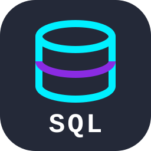

<!-- ═══════════════════════════════════════════════════════════════
     VICTOR.SYS  //  perfil de Victor Eduardo Ramos
     ═══════════════════════════════════════════════════════════════ -->

<div align="center">



<br/>

<a href="https://github.com/victor-eduardo-ramos">
  
</a>

<br/>


</div>


## ◈ `sobre_mim.py`

Sou estudante de **Sistemas de Informação na PUCPR** e fundador da **[WeForge](https://weforge.com.br)**, uma agência web que cria sites e sistemas de agendamento para negócios de todo o Brasil. Gosto de usar tecnologia para resolver problemas reais: na WeForge, montei um fluxo de prospecção automatizado com **agentes de IA** que já gerou **mais de 300 leads**.

Hoje meu foco é programar cada vez melhor: **Python, orientação a objetos, estruturas de dados** e projetos que eu construo do zero, como uma recriação do *Missile Command* em Pygame.

```python
class Victor:
    def __init__(self):
        self.nome       = "Victor Eduardo Ramos"
        self.local      = "Curitiba, PR, Brasil"
        self.formacao   = "Sistemas de Informação @ PUCPR"
        self.cargo      = "Fundador @ WeForge"
        self.foco       = ["Python", "POO", "Automação com IA", "Dados"]
        self.aprendendo = ["Estruturas de Dados", "Algoritmos", "SQL"]
        self.idiomas    = {"Português": "Nativo", "Inglês": "Intermediário (B1)"}

    def status(self) -> str:
        return "Sistema online. Aberto a oportunidades de estágio."
```


## ◈ `tech_stack.json`

<div align="center">

<h3>⟢ Linguagens</h3>

&nbsp;
&nbsp;
&nbsp;


<h3>⟢ Bibliotecas e conceitos</h3>


</div>


## ◈ `ferramentas.cfg`

<div align="center">

<a href="https://skillicons.dev">
  
</a>

<br/><br/>


</div>


## ◈ `projetos/`

<div align="center">

<table>
  <tr>
    <td colspan="2" align="center" width="100%">
      <br/>
      <h3>⚡ WeForge // Agência Web + IA</h3>
      <p>Agência que cria sites institucionais e sistemas de agendamento online para negócios de todo o Brasil.<br/>
      Inclui um fluxo de prospecção com <b>agentes de IA</b>: busca empresas no Google Maps, gera a abordagem<br/>
      e publica um protótipo do site na Vercel. <b>Mais de 300 leads gerados.</b></p>
      
      
      
      <br/><br/>
      <a href="https://weforge.com.br"></a>
      <br/><br/>
    </td>
  </tr>
  <tr>
    <td width="50%" valign="top">
      <h3>🚀 Missile Command</h3>
      <p>Recriação do clássico do Atari em <b>Python + Pygame</b> com orientação a objetos: projéteis guiados por vetores, chefes com <b>herança</b>, ondas progressivas, ranking salvo em JSON e o <b>clima real de Curitiba</b> (API Open-Meteo) mudando dia/noite, chuva e dificuldade.</p>
      
      
      
      <br/><br/>
      <a href="https://github.com/victor-eduardo-ramos/missile_command"><b>›› ver repositório</b></a>
    </td>
    <td width="50%" valign="top">
      <h3>📚 Gerenciador de Mangás</h3>
      <p>Programa de terminal em <b>Python</b> que cadastra, lista e remove mangás da coleção, com <b>validação de entradas</b>, tratamento de erros com <code>try/except</code> e persistência dos dados em <b>JSON</b>.</p>
      
      
      
      <br/><br/>
      <a href="https://github.com/victor-eduardo-ramos/gerenciador-de-mangas"><b>›› ver repositório</b></a>
    </td>
  </tr>
  <tr>
    <td width="50%" valign="top">
      <h3>📊 Análise de Dados: Netflix</h3>
      <p>Análise do catálogo da Netflix em planilha. Identifiquei e corrigi uma <b>inconsistência de dados que afetava mais de 3 mil registros</b>, usando fórmulas condicionais para padronizar a duração de filmes e séries.</p>
      
      
      <br/><br/>
      <a href="https://github.com/victor-eduardo-ramos/analise-da-netflix"><b>›› ver repositório</b></a>
    </td>
    <td width="50%" valign="top">
      <h3>🔐 Site com Login e Painel Admin</h3>
      <p>Site institucional com <b>autenticação</b>, painel administrativo, sistema de permissões e cupons de desconto, integrado ao <b>Supabase</b>. Construído com apoio de ferramentas de IA, com escopo e funcionalidades definidos por mim.</p>
      
      
      <br/><br/>
      <a href="https://github.com/victor-eduardo-ramos/aromagrao"><b>›› ver repositório</b></a>
    </td>
  </tr>
</table>

</div>


## ◈ `objetivos.sh`

<div align="center">
  
</div>


## ◈ `telemetria/`

<div align="center">


</div>


## ◈ `conquistas/`

<div align="center">
  <a href="./assets/certificado-mencao-honrosa.jpg">
    
  </a>
</div>

<br/>

<div align="center">
  
</div>

<br/>

<div align="center">
  <picture>
    <source media="(prefers-color-scheme: dark)" srcset="https://raw.githubusercontent.com/victor-eduardo-ramos/victor-eduardo-ramos/output/github-snake-dark.svg"/>
    <source media="(prefers-color-scheme: light)" srcset="https://raw.githubusercontent.com/victor-eduardo-ramos/victor-eduardo-ramos/output/github-snake.svg"/>
    
  </picture>
</div>


## ◈ `conexoes.net`

<div align="center">

<a href="https://linkedin.com/in/victor-eduardo-ramos"></a>&nbsp;
<a href="mailto:victoreduardoramos50@gmail.com"></a>&nbsp;
<a href="https://github.com/victor-eduardo-ramos"></a>&nbsp;
<a href="https://weforge.com.br"></a>

</div>

<br/>

<div align="center">


<sub><code>VICTOR.SYS v2026</code> · sistema em constante atualização · feito em Curitiba</sub>

</div>
